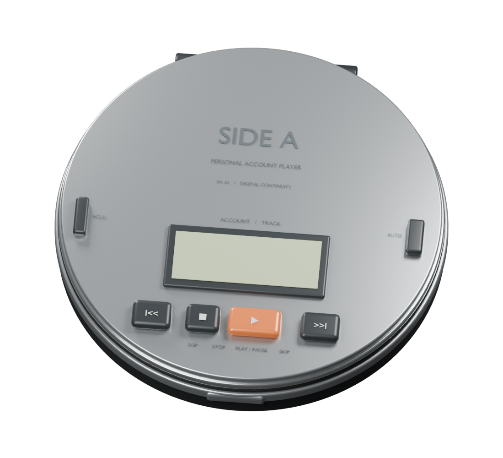

# Side A

**Your coding accounts, a track apart.**

A macOS menu bar app for people with several Claude Code and Codex accounts. It shows every
account's limits, moves running Claude Code sessions to another account before a limit hits,
and lets you answer your sessions from the notch. Built with SwiftUI and a stdlib-only Python
bridge, plus an optional 3D Discman-inspired player made from an original Blender model.

<p align="center"></p>

## What it does

Side A lives in the menu bar. Settings has six tabs: **Accounts**, **Sessions**, **Usage**,
**Autopilot**, **Setup** and **General**.

### Accounts and limits

- **Every limit at a glance.** The menu lists each account's 5-hour and weekly limits (plus
  the weekly Fable, Opus or Sonnet cap when the account reports one) with their reset times.
  The menu bar icon shows the tightest limit of the account in use. The 3D player is optional
  (Settings > General > 3D player).
- **Background sign-in.** Settings > Accounts > Add account opens the official browser sign-in
  and verifies the account by itself. The login this Mac already uses is added with one click.
  Side A warns three days before a sign-in ends; Sign in again is in each account's menu.
- **Always-current readings.** Accounts your sessions use are read every three minutes (every
  90 seconds near a limit), other accounts every ten, and an account at its limit hourly. An
  expired login is renewed the way Claude Code renews it.
- **Live limits from Claude Code** (Settings > Autopilot, on by default). Side A wraps your
  Claude Code statusline, so every reply records that account's limits; your own statusline
  still runs with the same input. While replies report, the usage endpoint is read only every
  15 minutes.
- **Claude incidents.** Every five minutes Side A checks status.claude.com. When an incident
  affects Claude Code or the API, the menu shows it (click to open the status page), and Side A
  notifies you once, so errors in your sessions aren't mistaken for an account problem.

### Autopilot

Turn it on in Settings > Autopilot. It picks the Claude account with the most quota at risk:
weekly percent left ÷ hours until the weekly reset × plan size. Among near-ties it uses the
account whose 5-hour window resets soonest, and it does not flip back and forth.

- **Running sessions move.** When an account your sessions use reaches **Move at** (default 95%
  of its 5-hour or weekly limit), Autopilot trades its login with an account no session is
  using. The sessions continue as the new account within about 30 seconds; nothing restarts.
  It moves only to an account with room on every limit, unless none has.
- **Per login, by model.** Each running login is planned by the models its own sessions use.
  With **Follow Fable** on, Fable sessions go to the account with the most Fable left. When a
  login's Fable sessions have spent their account's Fable share and no free account has any,
  Side A trades with a login whose sessions run only other models, if the spent account still
  has room for those.
- **Cache-aware timing.** A session moved to another account loses its prompt cache and resends
  its whole context. So a trade the account doesn't need yet waits until that login's sessions
  have been quiet for five minutes. An account that is out of room moves at once.
- **Limit replies count.** If a session's latest reply is Claude Code's limit message, Side A
  treats that account as full and trades right away, even while the usage endpoint is
  rate-limited. **React the moment a limit hits** adds a silent hook so this happens instantly.
- **Window priming.** A 5-hour window starts only at an account's first message. During your
  usual hours (learned from a week of activity), Autopilot sends one tiny Haiku message to idle
  accounts that are in Autopilot, so their windows start, and reset, earlier.
- **Switch in Terminal** adds one line to `~/.zshrc` so new `claude` commands use the account
  Autopilot picks. `sidea use <name>` keeps one terminal on one account; `sidea auto` hands it
  back. Open Terminal on an account does the same from the menu.
- **Hosted sessions.** Using the tmux that ships inside the app, Resume and Branch start the
  session in Side A's own tmux server and open a tab attached to it. It looks the same, but
  closing the tab only detaches: the session keeps running, and `sidea attach` (or Show) brings
  it back. `sidea ls` lists them. **Host terminal sessions** does the same for `claude` and
  `codex` typed in a terminal (`SIDE_A_NO_HOST=1 claude` skips it once). Inside tmux the
  terminal's own scrollback no longer holds the conversation; the mouse wheel scrolls tmux's.
- Codex accounts are read and primed, never switched; switch Codex with `codex login`.
- **Why it did or didn't move.** Every decision is written with its reason to
  `~/Library/Application Support/SideA/runtime/autopilot.log`: waiting for a pause, a failed usage
  read, sessions that couldn't be listed, no account with room, or a move that failed. If a move to
  an account with room fails, Side A notifies you, so you can switch from the menu.

### Usage

Settings > Usage shows tokens by day, project and model (Claude and Codex separately), when
you work, weekly pace per account, and paid usage (usage-credit spend, with a warning before
the account in use would start billing credits).

- **Worth at API prices:** what the same Claude tokens would cost on Anthropic's API at list
  prices, for the last 7 and 30 days and by model. Prices come from LiteLLM's public price list
  (the one ccusage uses), fetched daily and kept for offline use; Side A's own October 2026 table
  covers the time before the first fetch. Most of the value is prompt cache: every step resends
  the conversation, mostly as cache reads. Codex isn't included.
- **Notify when an account's week passes** 50%, 75% or 90% (Off by default): one notification
  per account each week.

### Sessions

Settings > Sessions searches every Claude Code and Codex conversation on this Mac: what you
asked, the replies, and the commands that ran. The list shows sessions waiting on you first,
then running sessions, your pins, then each project, with branches under the conversation they
came from. New conversations appear within a second. Open a running session's terminal tab, or
resume an old one in Ghostty, iTerm, Warp or Terminal. ⌘F finds within a conversation. Pin,
rename or archive conversations; this stays in Side A and never touches Claude's or Codex's
files. The index is a local SQLite file; `claude -p` and `codex exec` runs are hidden unless you
include them. Settings > General > Session search shows its size and can rebuild it.

**Running** lists each Claude Code session that is working, with the step it is on ("Editing
IslandView.swift", "Running pytest"), under the project it works in; a worktree counts as the
checkout it branches from. Idle sessions fold into one row that opens to show them. Sessions
keep their places, newest started first, and while the pointer is over the list nothing moves
between sections either; **Show updates** puts waiting changes in place. ↑ and ↓ step through
the list from search or from the list itself. A working session is flagged when it needs a look:

- no progress for 10 minutes,
- the same step 3 times among its last 6,
- 4 failed steps in a row.

An idle session with a context of 150k tokens or more, which every step re-reads, says so beside
"Idle".

Right-click a working session (or use its VoiceOver actions) to **Send a Note…** (it reads the note after its current step and
keeps it in mind) or **Stop Before Its Next Step**. **Take Back** cancels either before it is
delivered. This needs the Dynamic Island's Claude Code hooks (below).

Each running session shows the ports its processes listen on, and its memory once it holds 1 GB
or more; hover for the exact memory, counting everything it started (dev servers, test runners,
builds). Right-click it to open `localhost:<port>`, **Stop Server on :<port>…** (the session
keeps running) or **Quit Session…**. The Running label shows how many sessions run and their
total memory; when sessions have sat idle for 30 minutes or more, **Quit Idle…** on the idle row
quits them together, and each can be resumed later with `claude --resume`. When macOS reports memory pressure and sessions hold 4 GB
or more, the menu says memory is tight and Side A notifies you at most once an hour, before the Mac
starts to freeze.

### Setup

Settings > Setup is a read-only overview of what your agents run with: the Claude Code and
Codex CLIs and their versions, MCP servers from every scope (**Check Connections** runs
`claude mcp list`), hooks, skills and agents. Values of env and headers are never shown, URLs
show only their host, and commands only the program's name.

**Clean Up…** (under Storage) shows what your conversations take on disk, archives conversations
older than the age you pick into Side A's folder (pinned and running ones stay; **Restore
Archived** moves them back; nothing is deleted), and lists git worktrees your sessions left
behind, with **Remove…** for each. Removal never forces, so git keeps a worktree with changes,
and Side A also keeps one a session is working in, one whose commit is on no branch, and one with
ignored files like `.env` (folders a build brings back, like `node_modules`, don't count).

### Dynamic Island

Turn on **Settings > General > Dynamic Island**. Claude Code then asks for permission at the
notch; on a display without a notch the island is a pill under the menu bar (**Show on** picks
the display). Each request shows the command, or the file and a diff of the edit, plus the
project and the account.

- **Answer:** Allow, Deny, or Always (adds the rule Claude Code suggests). Several requests
  queue with a counter. Show terminal opens the session's tab. The terminal prompt stays open
  too; answer there and the island lets go.
- **Destructive commands** (such as `rm`, a force push, `git reset --hard`, a database drop, or a
  change to a credentials file or to Claude Code's or Codex's own settings) are marked and need a click. No shortcut or Always
  approves them.
- **Questions and plans.** Pick an answer to Claude's question or type your own. When Claude
  asks several at once, they show one at a time under tabs named for each question; picking
  an answer moves to the next, and Send answers goes on the last. Review a plan with Approve,
  Accept edits, or Revise… with a note for Claude.
- **Finished sessions.** When a session finishes, the island chimes and shows its last message,
  and a Ready list keeps it until you go to it. **Reply** sends its next task: the idle session
  wakes and starts on it, with nothing typed into your terminal. **Go** opens its terminal tab.
  A session paused on background work doesn't count as finished.
- **Away from the notch.** The same requests and finished sessions can be answered elsewhere:
  in **Sessions**, a waiting conversation shows its request with Allow, Deny and Always (or its
  question's options, or a plan's Approve), and a finished one, listed under **Finished**, has a
  box for its next task; the menu shows how many sessions wait for you or finished, and opens
  Sessions on them. Whichever you answer first wins.
- **Codex:** turn on **Codex permission requests**, then approve the hook once with `/hooks` in
  Codex. A Codex request left unanswered goes back to Codex's own prompt after two minutes.
  Codex sessions can't be woken, so Reply copies your text and opens the session's tab for you
  to paste it (the same happens for a Claude session that has waited more than an hour).
- **Also shown:** account changes, limits and Claude incidents (toggle: **Account changes and
  limits**), and sessions waiting for input (**Sessions waiting for you**). **Sessions that
  finish** turns the chime and Ready list on or off.

Shortcuts work only while something is waiting in the island:

| Keys | Action |
| --- | --- |
| ⌃⌥Y / ⌃⌥N / ⌃⌥A | Allow / Deny / Always |
| ⌃⌥1–4 | Pick an answer to the question showing |
| ⌃⌥G | Go to the session that finished last |
| ⌃⌥R | Reply to it with its next task |
| ⌃⌥T | Show the requesting session's terminal |
| ⌃⌥← / ⌃⌥→ | Previous or next request |
| ⌃⌥I | Move keyboard and VoiceOver focus into the island |

Go and Show terminal reach the exact tab in Ghostty, iTerm and Terminal (macOS asks once to let
Side A control them). Warp is reached through the link it gives each
session; older Warp builds fall back to its local session database, which needs Accessibility
permission (System Settings > Privacy & Security > Accessibility). Hosted sessions are reached
through the tab attached to them, and Show opens one when none is. Sessions inside your own
tmux or SSH can't be reached.

VoiceOver announces each request and what the shortcuts do; Reduce Motion swaps the springs for
fades; Increase Contrast is respected. **Show a sample request** tries it without a session.
See [how the island works](docs/architecture.md#dynamic-island) for the hooks it installs.

### General

- **Notify when a session needs you:** a notification when Claude Code asks for permission or
  input, even with Side A's windows closed. Clicking it opens that conversation. With the
  Dynamic Island on, a permission request's notification has **Allow** and **Deny** buttons;
  destructive requests, questions and plans open Sessions instead.
- **Sound effects:** soft player clicks for account changes, resumes and sessions that need you.
- **Keep awake while agents work** (off by default): while a Claude Code session is busy or
  running a background shell, or a Codex session wrote in the last 90 seconds, and for two
  minutes after, Side A holds a macOS power assertion so the Mac doesn't idle-sleep; the display
  still can. **Also with the lid closed** adds a small helper you approve once in Login Items, no
  password; it can only turn `pmset disablesleep` on and off, does so only while agents work and
  on power unless you allow battery (never below 20%), and gives sleep back when they stop, when
  you quit, 30 seconds after a crash, and at restart. The menu shows "Keeping awake · 3 agents
  working" when nothing more urgent is there. See [security](SECURITY.md#keep-awake).
- **Sync with your other Macs:** combines usage, working hours, your account list and your settings
  through iCloud Drive. Logins are never synced; sign in once on each Mac.
- **Remove Side A** undoes its shell line, statusline, hooks and keep-awake helper, deletes its caches and search
  index, and moves it to the Trash. Accounts stay unless you also choose to forget them.
- Only one copy of Side A runs at a time. Opened from Downloads or a disk image, it offers to move
  itself to Applications, where updates can install.

## Updates and privacy

Side A checks for signed, notarized updates and waits for your coding session to close before relaunching for an update. Disable background checks in Settings. Versions before 0.4 need one manual download to gain the updater. See [signed updates](docs/updates.md).

Anonymous app statistics are **off by default**. Opt in during setup or in Settings to send coarse setup and handoff events. No account details, code, project paths, recordings, or persistent identifiers are collected. See [analytics](docs/analytics.md).

Optional sync shares token totals, working hours, project paths, account names and emails, and Side A's settings with your other Macs through your iCloud Drive. Logins are never synced; sign in once on each Mac.

Besides the Anthropic and OpenAI endpoints the CLIs themselves use (usage, profile and login renewal), Side A contacts only the update feed (`getsidea.com/appcast.xml`), status.claude.com's public status summary (every five minutes, no account data), LiteLLM's public price list on GitHub (daily), and PostHog if you opted in to statistics. See [security and privacy](SECURITY.md).

A local diagnostic summary is available from Settings > General > Privacy or the Help menu. It contains only app, macOS and tool versions, whether Side A is in Applications, and why the last update failed; nothing is uploaded. See [recovery](docs/recovery.md).

## Run

Requires macOS 14+, Python 3.9+, and either
[Claude Code](https://code.claude.com/docs/en/setup) or
[Codex CLI](https://developers.openai.com/codex/cli) (tested: 0.148.0; requires remote TUI/app-server support).
Setup checks Python and the selected CLI automatically, and links to their official installers when needed; without Python it offers Apple's Command Line Tools installer, which includes one. It recognizes Homebrew, local-bin, and installed Apple developer-tool Python paths, and prefers Python 3.11 or later when one is installed: the island reads Codex's `config.toml` with its `tomllib`. Python uses only its standard library.

Build with Xcode 16+ / Swift 6:

```sh
./scripts/build-app.sh
open "dist/Side A.app"
```

The build is locally ad-hoc signed, **not notarized for public distribution**.
The app may be moved to Applications. It needs access to its own
Application Support directory and your Keychain; it is not App Sandbox
compatible because it runs the coding CLIs and manages their Keychain logins.

For an isolated interface preview with fictional accounts:

```sh
open -n "dist/Side A.app" --args --demo
```

Preview mode does not authenticate or launch coding sessions.

## Connect

1. Open the menu bar item and press **Add** next to the login this Mac already uses.
2. In Settings > Accounts > **Add account**, choose Claude or Codex, name the account, then
   **Add Account**. Finish in the browser; Side A verifies the identity when the CLI returns.
3. Turn on **Switch in Terminal** (Settings > Autopilot), then leave **Autopilot** on or press
   **Use** on an account. On the optional 3D player, PLAY uses the on-deck account.
4. Optional: turn on **Dynamic Island** in Settings > General to answer sessions from the notch.

## How switching works

Every login lives in exactly one place: Claude Code's default Keychain item (the Mac
login) or a profile slot. Side A never copies a login. Refresh tokens rotate, so two
copies of one login eventually invalidate each other (Codex revokes the login outright).

Running sessions move too. A session re-reads its Keychain item about every 30 seconds,
so when an account with running sessions nears its limit, Autopilot trades its login with
an account no session is using (under both logins' refresh locks). The sessions continue
as the fresh account; `runtime/homes.json` records which slot holds which account.
When a session's latest reply is Claude Code's limit error, Side A finds it through Claude
Code's session list (`~/.claude/sessions`) and counts that limit as full until a newer
reading, so the trade happens even while the usage endpoint is rate-limited.

Choosing an account writes its profile path (empty for the Mac login) to
`runtime/claude-selector`. With switching turned on,
one marked line in `~/.zshrc` reads that choice before each command (so aliases work) and sets
`CLAUDE_SECURESTORAGE_CONFIG_DIR`, so the command uses that account's own Keychain item
while settings, history and hooks stay in `~/.claude`. Apps that start `claude` outside your shell use the Mac login.

Side A identifies every login by its token (profile endpoint, cached per token) and
refuses a slot that holds another account's login or one it cannot verify yet. An expired
login is renewed the way Claude Code does it, under Claude Code's refresh lock. Starting a
5-hour window runs the CLI, which refreshes that account's login itself.
Codex accounts are tracked and primed; switch Codex itself with `codex login`.

## Development

```sh
python3 -m unittest discover -s bridge/tests -v
swift test
./scripts/build-app.sh release
```

The build script copies the canonical bridge into app resources before compiling.
Local builds are "Side A Dev" (`com.arnenoori.sidea.dev`, no updater), so they never update over themselves
or collide with an installed copy; only one copy of Side A runs at a time. Release builds set `SIDEA_RELEASE_BUILD=1`.
Do not edit the generated resource copy. The build also compiles the bundled tmux (`scripts/build-tmux.sh`, sources pinned by SHA-256; see [ACKNOWLEDGEMENTS.md](ACKNOWLEDGEMENTS.md)); development runs without it use Homebrew's tmux 3.4 or later. Sparkle 2.9.6 is pinned for signed automatic updates; the bridge needs no third-party Python packages. CI runs both suites and builds verified app artifacts on native
Apple Silicon and Intel Macs. The [distribution guide](docs/distribution.md)
describes the gated signing, notarization, and public-release pipeline.
The `site/` directory contains the minimal Three.js download page. Public releases
include a custom DMG, a ZIP alternative, and checksums. Signing credentials are
required before the first public release can be published.

Rebuild the model (Blender 5.2 was used):

```sh
/Applications/Blender.app/Contents/MacOS/Blender --background --python design/build_discman.py
```

`design/SideA.blend` is the editable source. The script exports evaluated mesh data
into the native app and renders the reference image. This is original artwork
inspired by portable CD players, not a Sony product or an exact model replica.

See [architecture](docs/architecture.md), [security](SECURITY.md),
[design decisions](docs/design.md), and [validation](docs/validation.md).

MIT License. Copyright © 2026 Arne Noori. See [LICENSE](LICENSE). Claude, Codex and other third-party names belong to their owners.
